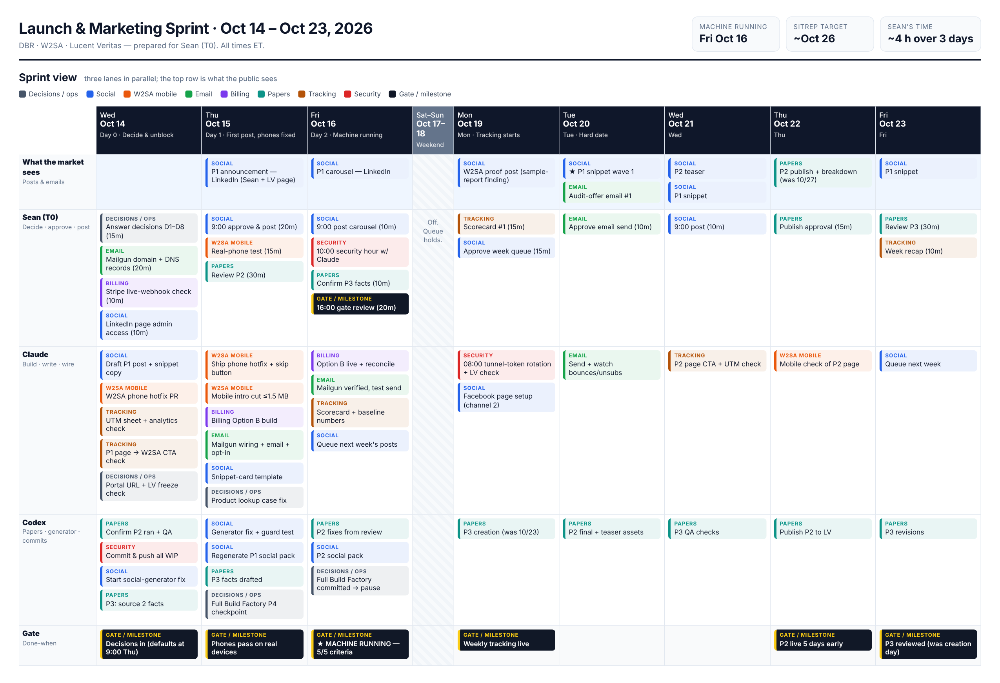
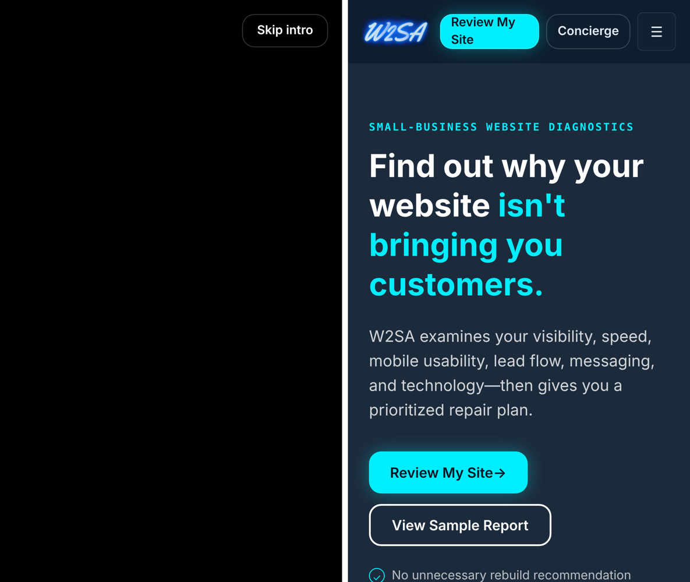
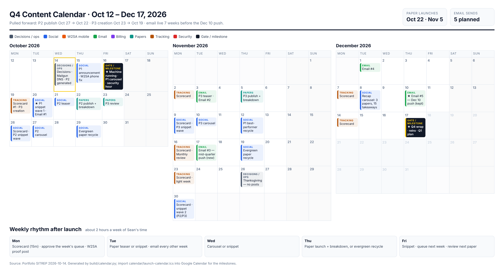

# Launch & Marketing Playbook — DBR · W2SA · Lucent Veritas

**Prepared:** 2026-10-14 (Wed) · **For:** Sean (T0) · **Source:** Portfolio SITREP 2026-10-14 · **Times:** ET

---

## 0. Bottom line

- **New target: the marketing machine is running by Fri Oct 16 (Day 3), not ~Oct 26.**
  - All 5 "launched and marketing" criteria are green Friday at 16:00.
  - The weekly scorecard starts Mon Oct 19.
- **Why it can go faster than two weeks:**
  - Most open items are decisions, settings, and small fixes. Very little is real building.
  - Three lanes run in parallel: Sean, Claude, and Codex.
  - Sean's time is the only real limit, so his work is grouped into two short windows a day (~4 h total over 3 days).
  - Every decision has a recommended default. That way a slow answer doesn't stall the work.
- **The only long wait is Mailgun DNS verification** (it can take up to 48 h). So the DNS records go in **today**. There's also a fallback that needs no DNS at all (§7.3).
- **Don't wait on the social-post generator fix.** Claude writes the P1 posts by hand today. Codex fixes the generator in parallel, in time for P2.
- **Phones:** I ran a quick phone test of w2sa.online today. It found a concrete problem: a **6.3 MB intro video** behind a black screen. A one-hour hotfix (skip the intro on phones) clears it (§7.2).
- **The money path stays untouched while traffic ramps up.** For billing I recommend **Option B**: DBR only reads W2SA's Stripe account and changes nothing.

### What changes vs. the SITREP plan

| Milestone | SITREP plan | This playbook | Gain |
|---|---|---|---|
| First social post (P1 announcement) | This week (Oct 14–19) | **Thu Oct 15** | Locked to Day 1 |
| W2SA works on phones | This week | **Thu Oct 15** hotfix · Fri full pass | 2–4 days |
| Revenue visible in one place | This week (after decision) | **Fri Oct 16** | 1–3 days |
| Audit-offer email can go out | This week | **Fri Oct 16** (1:1 fallback today) | 1–3 days |
| All 5 "launched" criteria green | ~Oct 26 | **Fri Oct 16** | ~10 days |
| P3 research (2 sourced facts) | Before Oct 23 | **Fri Oct 16** | 1 week |
| P3 creation | Oct 23 | **Mon Oct 19** | 4 days |
| P2 publish | Oct 27 | **Thu Oct 22** | 5 days |
| First audit-offer email to a list | Blocked (no email channel) | **Tue Oct 20** | Unblocked |
| P1 snippet wave 1 (hard date) | Oct 20 | **Oct 20, kept**, queued by Fri | On time, no scramble |

---

## 1. The funnel we're switching on

From the live sites, the money path is:

1. **Lucent Veritas paper**: P1, *The 2027 Small Business Digital Readiness Report*.
2. **Social post**: LinkedIn post, snippet card, or carousel.
3. **P1 page on lucentveritas.com**, which needs a visible CTA to the next step.
4. **W2SA free Digital Health Check**: `w2sa.online/digital-health-check`. Each submission creates a lead in the DBR CRM.
5. **Paid W2SA Diagnostic Dossier**: $199–$1,200, paid through Stripe.
6. **Fix My Website** ($500–$4,000) or **Replace My Website** ($2,250–$6,500).

- Side path: LV commissioned white papers, booked through the Cal.com `lv-white-paper-planning` link.
- Every step needs three things:
  - A link with UTM tags (§7.6).
  - A page that works on a phone (§7.2).
  - A number on the weekly scorecard (§7.6).
- **Check today (15 min):** does the P1 page clearly link to the W2SA Digital Health Check? If it doesn't, social traffic dead-ends on the paper. This is the cheapest fix in the whole plan.

---

## 2. Decisions — answer today

- Reply with just the numbers you **disagree** with. Anything unanswered by **9:00 Thu Oct 15** takes the default.
- D1–D5 keep the SITREP's order. D6–D8 are new.

| # | Decision | Recommended default | Why | Unblocks |
|---|---|---|---|---|
| D1 | W2SA revenue visibility | **Option B**: DBR's dashboard reads W2SA's Stripe account through a read-only restricted key | Doesn't touch the live checkout while we drive traffic. Takes hours, not days. Easy to undo. Option A can come later if it's still needed. | Gate 2 |
| D2 | Social channels & posting | **LinkedIn now**: Sean's personal profile is the main voice, the LV and W2SA company pages repost. **Facebook (W2SA page) in week 2.** X and Instagram wait. Post by hand in week 1, then use LinkedIn's built-in scheduler (or one tool such as Buffer or Postiz once there's more than one channel). | The paper → LinkedIn rhythm is already the plan. Personal profiles usually reach far more people than company pages. Small-business owners are heavy Facebook users. | Gate 3, the whole social lane |
| D3 | Set up Mailgun now? | **Yes, today.** Send from a subdomain such as `mg.w2sa.online`. | Your condition for restarting it is met. The DNS wait is the longest item in the plan. | Gate 4 |
| D4 | Full Build Factory | **Commit and push P1–P3 today. Commit a tested P4 checkpoint by Fri Oct 16. Then pause** (unless Billy's is a paying job — Sean confirms). | Protects work that only exists locally right now. Frees up Codex. | Codex lane |
| D5 | Freeze | **Confirm the freeze:** LUVK, NCC remediation, Amatrix/HRC/HAWL, new Nexus agent work | Rule: if it doesn't get a post out, convert a visitor, or make revenue visible, it waits. | Focus |
| D6 | Which brand sends the email | **W2SA**, signed by Sean. The LV paper is the hook. | The audit offer is a W2SA product, and its buyers are small businesses. | Email copy |
| D7 | Dormant projects | **Archive** SITREP Intelligence, Knowledge Engine, and the WP_Distribution video build (manual posting replaces it). **Keep** the HAWL/Amatrix/HRC playbooks as frozen documents. | Clears noise. Nothing is lost. | Can wait until Fri |
| D8 | Post approval rule | **Sean approves the first 3 posts. After that, posts built from approved templates go out unless Sean vetoes them in the queue.** | Keeps Sean from becoming the bottleneck from week 2 on. | Steady-state cadence |

---

## 3. Operating rules for the sprint

- **The freeze test:** does this get a post out, convert a visitor, or make revenue visible? If not, it waits.
- **Frozen:** LUVK (v1 and v2), the LUVK local-AI switch, NCC remediation, Amatrix/HRC Stripe accounts, the `dbr_projects` table, EASS judge wiring, the LV multi-tenant vault, NDRS, voice/narration, and new Nexus agent work.
- **Allowed small builds, because they feed the funnel:**
  - W2SA phone fixes.
  - Option B billing view.
  - Mailgun wiring plus an opt-in form.
  - Snippet-card template.
  - Social-generator fix.
  - Product-lookup letter-case fix.
- **NCC alert noise:** it has reported 2 critical issues every 48 h for 7 weeks.
  - Spend 10 minutes confirming neither issue touches a live system (DBR, W2SA, LV).
  - If neither does, mute the alert until NCC is unfrozen.
- **Sean's time windows:**
  - **9:00–9:30**: approve and post.
  - **16:00–16:30**: review and decide.
  - Everything else comes to Sean as a short async item with a recommended answer.
- **Manual first, automate second.** Post natively for week 1. Turn on scheduling in week 2.
- **Protect work:** all uncommitted work gets committed and pushed today: WP Factory, LV, and Full Build Factory P1–P4.

---

## 4. Lanes & owners

- **Sean (T0)**: decisions, account access, DNS records, Stripe dashboard checks, Anthropic key rotation, real-phone tests, approving and posting.
- **Claude**:
  - W2SA phone fixes.
  - Option B billing view.
  - Mailgun wiring, email template, opt-in form.
  - P1 post copy and snippet-card template.
  - UTM links, analytics, and scorecard.
  - Security cleanup in code.
  - DBR small fixes.
- **Codex**:
  - P2 check and QA.
  - Social-generator fix with a guard test.
  - P1 and P2 social packs.
  - P3 research and creation.
  - Commit and push all WIP.
  - Full Build Factory checkpoint, then pause.

---

## 5. Day-by-day sprint (Oct 14–16): "Ignition"



### Day 0 — Wed Oct 14 (today): decide & unblock

- **Sean (~55 min)**
  - [ ] Answer D1–D8 (§2). 15 min.
  - [ ] Mailgun: add the sending domain (`mg.w2sa.online`) and put the DNS records it shows into your DNS provider. 20 min. **Starts the propagation clock.**
  - [ ] Stripe dashboard → Webhooks → the live endpoint. Confirm recent deliveries returned 2xx. 10 min. **Closes the 08-22 Sentinel P0 question.** If deliveries are failing, stop and fix that first: it's revenue.
  - [ ] LinkedIn: confirm you're an admin on the LV and W2SA company pages (create either page if it's missing). 10 min.
- **Claude**
  - [ ] Draft the P1 announcement and breakdown post, plus 6–8 snippet lines, by hand from the P1 paper. Templates are in Appendix A.
  - [ ] Open the W2SA phone hotfix PR: skip the intro on phones and make the skip button bigger (§7.2).
  - [ ] Build the UTM link sheet (§7.6). Confirm analytics records UTM-tagged visits on both sites.
  - [ ] Check that the P1 page has a clear CTA to the W2SA Digital Health Check, with UTM tags.
  - [ ] Check the client portal's public address. Confirm with Codex that the LV deploy freeze is lifted, and note it in the LV sitrep.
- **Codex**
  - [ ] Confirm P2 generated at 09:00 ET and run its quality checks. Flag it for Sean's review.
  - [ ] Commit and push all uncommitted work: WP Factory, LV, and Full Build Factory P1–P4 branches.
  - [ ] Start the social-generator fix (already defined in the WP Factory sitrep).
  - [ ] P3: find two facts with primary sources.
- **Done when:** decisions are in, DNS records are added, the webhook is confirmed healthy, and no work exists only on a local machine.

### Day 1 — Thu Oct 15: first post, phones fixed

- **Sean (~65 min)**
  - [ ] **9:00** Approve and post the **P1 announcement** on LinkedIn (personal profile), then repost it from the LV page. 20 min.
  - [ ] Real-phone test after the hotfix ships (checklist in §7.2). 15 min.
  - [ ] **16:00** Review P2. 30 min.
- **Claude**
  - [ ] Ship the phone hotfix. Then make a mobile cut of the intro: portrait, ≤1.5 MB, with a poster image.
  - [ ] Build the Option B billing view (§7.4).
  - [ ] Mailgun wiring: audit-offer email template, unsubscribe handling, and an opt-in on the P1 page and the Health Check form (§7.3).
  - [ ] Snippet-card template, rendered from code (4:5, 1080×1350). No Canva time needed from Sean.
  - [ ] Product-lookup fix: compare brand keys in lowercase, and add one test.
- **Codex**
  - [ ] Land the social-generator fix plus a guard test (§7.5). Regenerate the P1 social pack and compare it with Claude's hand-written version.
  - [ ] Draft the P3 facts with sources.
  - [ ] Full Build Factory: commit a tested P4 checkpoint.
- **Done when:** P1 is posted, W2SA passes on a real iPhone and Android (including inside the LinkedIn app), and the Option B view shows data.

### Day 2 — Fri Oct 16: machine running

- **Sean (~100 min)**
  - [ ] **9:00** Post the **P1 carousel** (a LinkedIn document post). 10 min.
  - [ ] **10:00** Security hour with Claude (§7.7). 60 min.
  - [ ] Confirm the P3 facts. 10 min.
  - [ ] **16:00** Gate review against §10. 20 min.
- **Claude**
  - [ ] Turn on Option B. Reconcile one week of W2SA charges against the Stripe dashboard.
  - [ ] Mailgun domain verified. Send a test of the audit-offer email to Sean, then fix anything that renders badly.
  - [ ] Scorecard live with baseline numbers (§7.6).
  - [ ] Queue next week's posts. P1 snippet wave 1 is set for Tue Oct 20.
- **Codex**
  - [ ] Apply the P2 fixes from Sean's review. Build the P2 social pack with the fixed generator.
  - [ ] Full Build Factory committed and tested → **pause**.
- **Done when:** all 5 gate criteria are green (§10).

### Weekend — Oct 17–18

- Nothing scheduled. The queue holds. LinkedIn engagement is low on weekends anyway.

---

## 6. Week 1 (Oct 19–23): run the cadence

- **Mon Oct 19**
  - Scorecard #1 (Sean, 15 min). Approve the week's post queue (15 min).
  - Public: **W2SA proof post**, a finding from the sample report (e.g., "contact form fails on mobile").
  - Claude: rotate the tunnel token at **08:00** with an LV uptime check (§7.7). Set up the Facebook W2SA page (channel 2).
  - Codex: **P3 creation** (was Oct 23).
- **Tue Oct 20 — hard date**
  - Public: **★ P1 snippet wave 1** and **audit-offer email #1**.
  - Sean approves the send (10 min). Claude sends it and watches bounces and unsubscribes.
  - Codex: final P2 and teaser assets.
- **Wed Oct 21**
  - Public: **P2 teaser** and a P1 snippet.
  - Claude: check the P2 page CTA and UTM tags.
  - Codex: P3 QA checks.
- **Thu Oct 22**
  - Public: **P2 publish + breakdown post** (was Oct 27).
  - Claude: phone check of the P2 page.
- **Fri Oct 23**
  - Public: a P1 snippet.
  - Sean reviews P3 (30 min) and does a 10-min week recap.
  - Codex: P3 revisions.

---

## 7. Workstream runbooks

### 7.1 Social distribution

- **Channels (D2 default):**
  - LinkedIn: Sean's personal profile is the main voice. The LV and W2SA company pages repost.
  - Facebook: W2SA page from week 2.
  - X and Instagram: parked until the scorecard shows LinkedIn working.
- **Post types:**
  - **Announcement/breakdown**: hook, 3 findings, the "so what," then a CTA. 150–250 words.
  - **Snippet**: one stat or finding on a 1080×1350 card, plus 2–3 lines of copy and a CTA.
  - **Carousel**: a 6–10 slide PDF uploaded as a LinkedIn document post, 1080×1350 per slide.
  - **W2SA proof post**: one common website problem, why it costs customers, and a link to the free check.
- **Links:**
  - Every link carries UTM tags (§7.6).
  - Test both placements: link in the post body vs. link in the first comment. Keep whichever gets more clicks on the scorecard.
- **CTA:** the primary CTA is the **W2SA free Digital Health Check**. The secondary CTA is reading the full paper.
- **Posting steps (manual, week 1):**
  - Post from Sean's profile at 9:00 ET on weekdays.
  - Repost from the company page within an hour.
  - Reply to every comment the same day.
- **Week 2:** schedule the week's posts on Monday in LinkedIn's built-in scheduler. Move to one scheduling tool once Facebook is added.
- **Graphics:**
  - Claude renders snippet cards and carousels from one code template, so they stay on-brand at no extra cost.
  - Canva stays available for one-off edits.

### 7.2 W2SA mobile pass

- **What I found today:** a phone simulation on a desktop test browser (emulated iPhone 13 at 390×664 and Pixel 7 at 412×839). This is **not** a substitute for a real phone.
  - **The intro video `intro-reveal.mp4` is 6.3 MB** (6,275,995 bytes). There's one version, no poster image, and phones download all of it. That's ~93% of the homepage's 6.4 MB load.
    - That's roughly **5 s on a 10 Mbps connection and 12+ s on a weak 4 Mbps signal.**
  - While the video loads, a phone shows a **full-screen black overlay with only "Skip intro"** on it. Social visitors decide in seconds.
  - **"Skip intro" is ~98×38 px with 14 px text.** That's below the 44×44 px minimum tap size.
  - The video uses `object-fit: cover` on a tall portrait screen. A landscape video gets its sides cropped heavily, which is likely the "intro crop" issue. Confirm on a real phone.
  - **Good:** when the video can't play, the intro closes itself after ~3.4 s and the page works. There's no sideways scrolling at 390 or 412 px.
  - **Minor:** the header "Review My Site" button wraps onto two lines at 390 px, and the logo loads as a 260 KB image.
  - **Limit:** the test browser can't play this video format (H.264), so I couldn't see the animation itself. The real-phone test is still required.



- **Fixes, in order:**
  1. **Hotfix (≤1 h):** on screens ≤768 px wide, or when the visitor has Data Saver on or reduced motion set, skip the intro and show the hero straight away. Until a mobile cut exists, the intro runs on desktop only.
  2. **Skip button:** make it at least 44 px tall, keep it clear of the iPhone notch area (`env(safe-area-inset-top)`), and give it higher contrast.
  3. **Mobile cut:** a 9:16 or 4:5 version at 720p, H.264, **≤1.5 MB**, with a poster frame and `preload="metadata"`. Turn the intro back on for phones only if it still loads fast.
  4. **Header CTA:** use the short "Review Site" label below 400 px.
  5. **Logo:** serve a correctly sized WebP/AVIF (aim for under 40 KB).
- **Real-phone test checklist (Sean, 15 min):**
  - [ ] iPhone Safari and Android Chrome.
  - [ ] **LinkedIn in-app browser**: tap your own post's link. Social clicks open here, not in Safari or Chrome.
  - [ ] Facebook in-app browser (week 2).
  - [ ] First screen appears in under 3 s on cellular with Wi-Fi off.
  - [ ] Tap "Review My Site," submit the Digital Health Check, and confirm the lead shows up in the DBR CRM.
  - [ ] Open the Dossier checkout and confirm the Stripe page loads (no purchase needed).
  - [ ] Repeat for lucentveritas.com and the P1 page.

### 7.3 Email channel (Mailgun)

- **Setup:**
  - [ ] Add the sending subdomain `mg.w2sa.online` in Mailgun (Day 0).
  - [ ] Add the DNS records Mailgun shows, typically SPF (TXT), DKIM (TXT), two MX records, and a tracking CNAME (Day 0).
  - [ ] Add DMARC on the root domain, starting at `p=none`: `_dmarc.w2sa.online TXT "v=DMARC1; p=none; rua=mailto:<you>"`. Gmail and Yahoo expect authenticated mail and easy unsubscribe.
  - [ ] Confirm the Mailgun plan can send to your list. Trial and sandbox setups only send to approved addresses.
  - [ ] Click verify in Mailgun. It can take minutes or up to 48 h.
- **Who gets the email (consent matters):**
  - The current Health Check consent covers "prepare my free preliminary diagnostic and follow up about it." **It does not cover marketing email.**
    - Add an **optional, unticked** box: "Send me the 2027 readiness report and occasional tips."
  - Add the same opt-in to the P1 page ("Email me the report + checklist").
  - Existing warm contacts in the DBR CRM: start with **1:1 personal emails**, not a bulk send.
- **Compliance (CAN-SPAM):** every email needs:
  - A real sender.
  - An honest subject line.
  - A postal address.
  - A working unsubscribe link (Mailgun's `%unsubscribe_url%`), honored promptly.
- **Warm-up:** keep early sends small, in the dozens. Watch the bounce rate and complaints before sending more.
- **Fallback if DNS isn't verified by Friday:** Sean sends the audit-offer email as personal 1:1 messages from his own inbox to 20–30 warm contacts. That needs no setup, can start today, and personal emails usually convert better anyway.
- **Draft email:** Appendix B.

### 7.4 Billing visibility — Option B

- [ ] In **W2SA's** Stripe account, create a **restricted key with read-only access** to Charges, Payment Intents, Checkout Sessions, and Balance Transactions.
- [ ] Store it in DBR's secrets (e.g., `STRIPE_W2SA_READ_KEY`). Never put it in a repo or an `.env.example` file.
- [ ] DBR pulls W2SA payments on a schedule, or adds a `checkout.session.completed` webhook in W2SA's account pointing at DBR. Tag these payments `source=brand-nexus`.
- [ ] **No double counting:** match on Stripe object IDs. Charges dbr-api already records must not appear twice.
- **Done when:** one known brand-nexus W2SA charge from the last 30 days appears in DBR with the right amount, and the weekly total matches the Stripe dashboard.
- **Later, only if two reporting sources become a problem:** Option A, routing brand-nexus charges through DBR. That's a change to the money path, so it waits until after launch.

### 7.5 Papers and the social generator

- **P2:** confirm it generated today at 09:00 ET and passed QA. Sean reviews Thu. Fixes Fri. **Publish Thu Oct 22.**
- **P1 social generator:**
  - Codex applies the fix already defined in the WP Factory sitrep.
  - **Add a guard test so the bug can't come back.** It fails if the output is shorter than ~300 characters, matches the slug, or is missing the hook, the 3 points, or the CTA link.
- **P3:**
  - Codex finds the two facts by Thu. Sean confirms Fri.
  - **Creation moves to Mon Oct 19.** If the schedule is automated and can't move, keep Oct 23 — the point is that P3 is no longer blocked.
  - Review Fri Oct 23. Teaser Tue Nov 3. **Publish Thu Nov 5 (proposed).**
- **Human scoring checks and old-paper keep/archive decisions:**
  - Batch them into one 45-min session in the week of Oct 26.
  - Kept papers become the **evergreen recycle** library for Thursday slots.

### 7.6 Tracking & the weekly scorecard

- **UTM convention:**
  - `utm_source` = `linkedin` | `facebook` | `email`
  - `utm_medium` = `social` | `email`
  - `utm_campaign` = `p1-readiness-2027` | `p2-<slug>` | `p3-<slug>` | `audit-offer`
  - `utm_content` = `announce` | `snippet-01…` | `carousel` | `proof-01…` | `email-01…`
  - Example: `https://w2sa.online/digital-health-check?utm_source=linkedin&utm_medium=social&utm_campaign=p1-readiness-2027&utm_content=announce`
- **Analytics:** confirm both sites record visits by UTM.
  - A quick scan of the LV homepage and its main script found no common analytics tag.
  - If none is present, add a lightweight one (Cloudflare Web Analytics, Plausible, or GA4) on Day 1.
- **Scorecard (Mondays, 15 min, starting in a Google Sheet):**

| Metric | Source |
|---|---|
| Posts shipped vs. planned | Calendar |
| Impressions, clicks, new followers | LinkedIn analytics |
| Site visits from social and email (by UTM) | Analytics |
| Digital Health Check submissions | DBR CRM |
| Bookings (LV + W2SA) | Cal.com |
| Checkouts and revenue (both Stripe accounts) | DBR (after Option B) |
| Emails sent, opened, clicked, unsubscribed, bounced | Mailgun |

- **First-month guardrails** (adjust after the Oct 19 baseline):
  - At least 4 posts a week, shipped on schedule.
  - At least one Digital Health Check submission a week by the end of October.
  - Bounce rate under 2% and complaint rate near zero.

### 7.7 Security hour (Fri Oct 16, 10:00–11:00, Sean + Claude)

- **Order matters.** The n8n workflows produce papers, so the key has to move **before** the old one is revoked. Doing it after P2 and before P3 creation avoids breaking a paper run.
  1. [ ] Create a new Anthropic API key in the console.
  2. [ ] In n8n, store it as a **credential** and switch WF-101 to WF-105 to use that credential. Run each workflow once and confirm it works.
  3. [ ] Change `white_papers\deploy_n8n_workflows.py` to read the key from an environment variable. Delete line 21's literal key. Commit.
  4. [ ] **Revoke the old key**, then re-run one workflow. *Deleting the key from the file doesn't remove it from git history. Revoking it is what closes the exposure.*
  5. [ ] Replace the Stripe test key in LV's `.env.example` with a placeholder (`sk_test_xxx`).
  6. [ ] **Mon Oct 19, 08:00:** rotate the tunnel token in `lv-tunnel-config.yml`, then check right away that lucentveritas.com still loads. Have a rollback ready. This is not a Friday-evening job, because a bad rotation takes LV offline.

### 7.8 DBR cleanup (small, allowed)

- Product-lookup letter-case mismatch: compare in lowercase plus one test (Day 1).
- Client portal public address: open it and confirm the HTTP status (Day 0).
- Two LV checkout paths: the risk is already accepted. Just confirm both show up in reporting.

---

## 8. Weekly rhythm after launch (about 2 h a week for Sean)

- **Mon**: scorecard (15 min), approve the week's queue (15 min), W2SA proof post.
- **Tue**: paper teaser or snippet, plus an email every other week.
- **Wed**: carousel or snippet.
- **Thu**: paper launch and breakdown, or an evergreen recycle.
- **Fri**: snippet, queue next week, review the next paper.
- **Each paper runs on a 2-week cycle:**
  - Week A: teaser, then publish and breakdown.
  - Week B: snippet wave and carousel.
  - Then it gets an email CTA in the next email slot, and its best post is recycled about a month later.

---

## 9. Q4 calendar (pulled forward)



| Week of | Main moves |
|---|---|
| Oct 12 | Decisions, Mailgun DNS, P2 generated (Wed). P1 announcement (Thu). **★ Machine running**, P1 carousel, security hour (Fri). |
| Oct 19 | Scorecard #1, P3 creation (Mon). **★ P1 snippet wave 1 + email #1 (Tue 20).** P2 teaser (Wed). **P2 publish (Thu 22).** P3 review (Fri). |
| Oct 26 | P2 snippet wave and carousel. Evergreen recycle. Batch the scoring checks and paper keep/archive decisions. |
| Nov 2 | P3 teaser + email #2 (Tue). **P3 publish (Thu Nov 5).** |
| Nov 9 | P3 snippet wave and carousel. Recycle P1's best performer. |
| Nov 16 | Monthly review. **Email #3, mid-quarter push (new, Tue Nov 17).** |
| Nov 23 | Thanksgiving week (Thu Nov 26): light, 2 scheduled posts. |
| Nov 30 | Snippet wave 2 (P2/P3). Email #4 (Tue Dec 1). |
| Dec 7 | Recap carousel: "3 papers, 15 takeaways" (Tue). **★ Email #5, Dec 10 push (kept: year-end timing suits a "2027 readiness" offer).** |
| Dec 14 | **★ Q4 wrap, retro, Q1 plan (Thu Dec 17).** |

- **Import the dates:** `calendar/launch-calendar.ics` works with Google Calendar (Settings → Import) or Apple Calendar.

---

## 10. Gate: "launched and marketing" (review Fri Oct 16, 16:00)

- [ ] **1. All three sites work on desktop and phones.** W2SA, LV, and the P1 page pass the §7.2 real-phone checklist, including the LinkedIn in-app browser. The DBR CRM works on a phone for Sean.
- [ ] **2. Revenue is visible in one place.** DBR shows dbr-api charges (W2SA and LV) and the brand-nexus W2SA charges (Option B). The weekly total matches Stripe.
- [ ] **3. At least one social channel posts on the calendar.** The P1 announcement and carousel are live on LinkedIn, and next week's posts are queued.
- [ ] **4. The audit-offer email can go out.** Either the Mailgun domain is verified, the template is tested, and unsubscribe works — or the 1:1 fallback is in progress.
- [ ] **5. Bookings and checkouts are tracked weekly.** The scorecard exists with baseline numbers, and the first Monday review is Oct 19.
- Also confirmed this sprint:
  - [ ] Live Stripe webhook healthy.
  - [ ] No uncommitted work.
  - [ ] Anthropic key rotated.

---

## 11. Risks & fallbacks

| Risk | Early sign | Fallback |
|---|---|---|
| Mailgun DNS slow to verify | Not verified by Fri 12:00 | Sean sends 1:1 emails from his inbox. The bulk send moves to Tue Oct 20 as planned. |
| Generator fix slips | Output still wrong on Thu | Keep writing posts by hand (already the Day 1 plan). The fix isn't needed until P2's pack. |
| Phone issues bigger than expected | Real-phone test fails on Thu | The hotfix (no intro on phones) already removes the main risk. Polish can follow. |
| Sean's time | Decisions or approvals stack up | Defaults apply at 9:00 the next day. D8 removes per-post approval from week 2. |
| Key rotation breaks n8n | A workflow fails after the switch | Don't revoke the old key until the new credential is proven (§7.7 order). |
| Live Stripe webhook unhealthy | Failed deliveries on Day 0 | Stop and fix first, then resend the failed events from Stripe. |
| Company pages get little reach | Low impressions in week 1 | Sean's personal profile is already the main channel. Add Facebook in week 2. |
| Option B double-counts | Totals don't match Stripe | Match on Stripe object IDs and reconcile weekly. |
| P2 fails review | Big fixes needed | Use the Oct 22 slot for an evergreen paper from the 20-paper library. P2 takes the Nov 5 slot. |

---

## 12. Parking lot (frozen or dormant — no action this sprint)

- **Frozen until the machine is running and the scorecard shows a trend:** LUVK v2 deploy, LUVK local-AI switch (waits for the new GPU PC), NCC, Amatrix/HRC Stripe accounts, the `dbr_projects` table, EASS judge wiring, the LV multi-tenant vault, NDRS, voice/narration, new Nexus agents.
- **Archive (D7):** SITREP Intelligence, Knowledge Engine, WP_Distribution video build.
- **Keep as frozen documents:** the HAWL, Amatrix, and HRC playbooks.
- **Out of scope:** Huladik (a separate brand).

---

## Appendix A — P1 post templates

**A1. Announcement + breakdown (LinkedIn, Sean's profile)**

```text
Most small-business websites aren't broken. They're quietly losing customers.

We just published The 2027 Small Business Digital Readiness Report.
Three findings stood out:

1) [Finding #1 — one line, with the number]
2) [Finding #2 — one line, with the number]
3) [Finding #3 — one line, with the number]

The pattern: [one-sentence "so what" for an owner].

Full report (free): [P1 link + UTM: utm_content=announce]

Want to know where your own site stands? W2SA runs a free
Digital Health Check — plain-English findings, no rebuild pitch:
[w2sa.online/digital-health-check + UTM]
```

**A2. Snippet card (one per finding)**

- **Card (1080×1350):**
  - The stat, large.
  - One line of context.
  - Source line: "2027 Small Business Digital Readiness Report · Lucent Veritas."
- **Post copy (2–3 lines):**
  - Why it matters to an owner.
  - A question for the reader.
  - A link to the free check (UTM `snippet-0N`).

**A3. W2SA proof post (Mondays)**

```text
A website can look fine and still lose customers.

The most common problem we find: [e.g., the contact form fails on phones].
What it costs: [e.g., every mobile visitor who tries to reach you gives up].
The fix is usually small: [one line].

Free Digital Health Check: [link + UTM: utm_content=proof-0N]
```

## Appendix B — Audit-offer email (W2SA, signed by Sean)

```text
Subject: Is your website ready for 2027? (free check)
Preview: A 2-minute form. A plain-English answer.

Hi {first_name},

We just published The 2027 Small Business Digital Readiness Report
with Lucent Veritas. The short version: [one-line finding].

The most common problems we see aren't expensive to fix — they're
just invisible:
  • contact forms that fail on phones
  • not showing up in local search
  • the main "call us" button buried below the first screen

If you'd like to know where your site stands, we'll do a free
preliminary Digital Health Check. No rebuild pitch, no obligation.

→ Start my free check:
https://w2sa.online/digital-health-check?utm_source=email&utm_medium=email&utm_campaign=audit-offer&utm_content=email-01

Sean
W2SA

[Postal address] · Unsubscribe: %unsubscribe_url%
```

## Appendix C — Files in this folder

- `LAUNCH_PLAYBOOK.md`: this playbook.
- `LAUNCH_PLAYBOOK.pdf`: the same playbook as a PDF.
- `calendar/launch-calendar.html`: the visual calendar (sprint view and Q4 view). Open it in a browser.
- `calendar/sprint-calendar.png` and `calendar/q4-calendar.png`: the calendar as images.
- `calendar/launch-calendar.ics`: import the milestones into Google or Apple Calendar.
- `assets/w2sa-mobile-baseline.png`: the phone-simulation screenshots.
- `build/`: rebuild everything with `bash build/build.sh` (needs Python 3, pandoc, Node, and Playwright).
